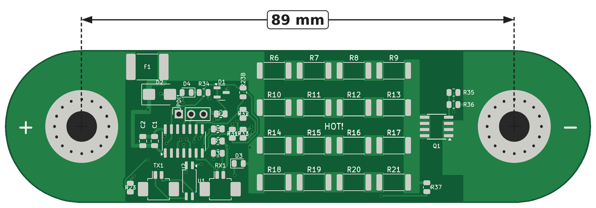
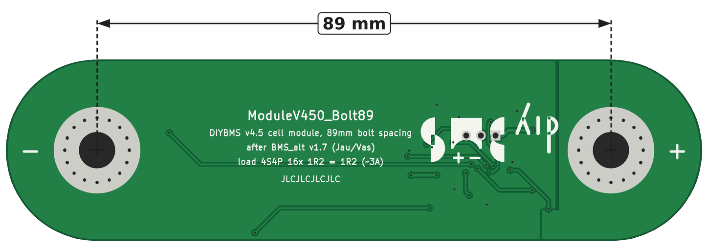
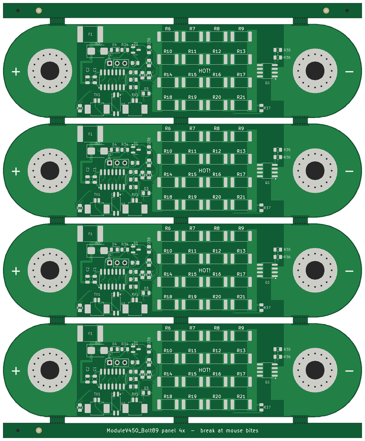

# ModuleV450_Bolt89

Variant of ModuleV450_Bolt123_V1 for **89 mm bolt spacing**, same outline style with rounded ends.
Same schematic, same BOM as Bolt123_V1, own layout.
DIYBMS v4.5 cell module (ATtiny1624), bolted directly onto the cell terminals. EMC-optimised layout.

| Top | Bottom |
|---|---|
|  |  |

## Ordering at JLCPCB – all files

| What | Single board | 4-up panel (recommended, "Panel by Customer") |
|---|---|---|
| Gerber + drill files | `ModuleV450_Bolt89_gerber_jlc.zip` | `panel4/ModuleV450_Bolt89_panel4_gerber_jlc.zip` |
| Bill of materials (BOM) | `ModuleV450_Bolt89_bom_jlc.csv` | `panel4/ModuleV450_Bolt89_panel4_bom_jlc.csv` |
| Placement file (CPL) | `ModuleV450_Bolt89_cpl_jlc.csv` | `panel4/ModuleV450_Bolt89_panel4_cpl_jlc.csv` |
| Full BOM | `ModuleV450_Bolt89_bom_full.csv` | `panel4/ModuleV450_Bolt89_panel4_bom_full.csv` |

Settings: FR-4, 2 layers, 1.6 mm, 1 oz, green, lead-free HASL, PCB Assembly top side.
Panel: *Panel by Customer*, *Edge Rails/Fiducials*: none, *PCB Qty* = number of panels (5 panels = 20 modules), assembly quantity = number of panels.
Check in the JLC assembly preview: cathode band of D2 towards the VCC side (F1); pin-1 dots of U1, U2 and Q1 at the triangle in the silkscreen.

## Mechanical
| | |
|---|---|
| Board | **120.5 × 31.5 mm, rounded ends** (radius 15.75 mm around the bolts, as Bolt123_V1) |
| Bolt spacing | **89.0 mm** |
| Holes | **6.3 mm** drilled, plated (JLC maximum), Ø 15 mm bare copper ring top + bottom, 16 stitching holes Ø 0.6 mm |
| Left / right | Cell plus (BAT+) / cell minus (GND) |
| Layers | 2, 1.6 mm FR4, 1 oz |

## Layout concept (EMC)
* **Two zones:** quiet zone (plus side, x ≈ 9–34 mm) with MCU, reference D1, optocoupler,
  temperature sensors and connectors. Load zone (x ≈ 34–105 mm) with VCC bus, 16 load resistors,
  DRAIN bus, MOSFET Q1 and the minus bolt.
* **F1 outside the bolt area** (x = 13.5 mm, as Bolt123), plus connection via a copper tongue from the bolt ring.
* **Compact MCU area:** U2 with C1/C2 directly to its left, small parts in three rows to the right of U2,
  optocoupler U1 upright between TX1 and RX1, status LED D4 at the top next to the TVS diode.
* **Load resistors** in columns at x = 39.6 / 47.8 / 56.0 / 64.2 mm (8.2 mm pitch).
* **Q1 between DRAIN bus and minus bolt** (x = 73 mm), away from the bolt:
  Q1 pads ↔ copper ring ≈ 5 mm, ↔ hole centre ≈ 13.5 mm.
  Drain pins directly on the DRAIN bus, source pins via a copper tongue (4.8 × 11 mm) to the minus bolt.
  Gate network R35/R36 right above Q1.
* **Power paths as copper pours instead of tracks:**
  VCC feed 5.8 mm wide along the top edge, VCC bus 3.3 mm,
  series nodes between the resistors 4.2 × 4.2 mm each, DRAIN bus 3.3 mm over the full height. Remaining power tracks 1.5 mm.
* **Load current return:** Q1 source → GND tongue (top) → minus bolt.
  The switched load current does not flow through the MCU ground plane.
* **Star-point supply:** the MCU has its own supply branch
  (F1 → TVS D2 → C2 10 µF → C1 100 nF → U2 pin 1). It is not tapped from the load bus,
  so the ADC does not see the voltage drop caused by the balancing current.
* **Bottom side:** continuous GND plane as reference and shield, connected to the load path only at the
  minus bolt (star point).
* Board temperature sensor R32 right next to the VCC bus at the load block.
* The load block is ≈ 33 × 31 mm (Bolt123: 38 × 31 mm), so the heat is slightly more concentrated (≈ 11 W at 3.65 V).

## Electrical
* Load: **16 × 1.2 Ω 2512 (1 W, UniOhm 25121WF120KT4E, LCSC C46193)** – same resistors as BMS_alt.
  4 strings of 4 in series, in parallel = **1.2 Ω** (BMS_alt is 1.2 Ω in total as well) → **same current as the old board**:
  3.2 V: 2.6 A / 8.5 W · 3.4 V: 2.8 A / 9.6 W · **3.65 V: 3.0 A / 11.1 W** (0.69 W per resistor).
  Set `-DLOAD_RESISTANCE=1.20` in the firmware (see Firmware).
* **Q1 = AO4402** (SO-8, 20 V, 20 A, R_DS(on) max 7 mΩ at V_GS = 2.5 V, LCSC C115828)
  instead of AO3400A (SOT-23) or LONTEN LNG045R210 (TO-252, BMS_alt). ≈ 63 mW loss at 3 A; fully enhanced even at LiFePO4 cell voltage (V_GS ≈ 3 V).
  Gate via R35 510 Ω, pull-down R36 10 kΩ (as V450).
* **F1 = LUTE 2920L500/30GR** (PTC 2920, 5 A hold / 10 A trip, 30 V, 5 mΩ, LCSC/JLC C19078763, ≈ $0.16)
  instead of mSMD150. Still holds ≈ 3.5 A at 60–70 °C, i.e. above the max. balancing current of 3.0 A
  (the BMS_alt had only 3 A hold = right at the limit). Voltage drop at 3 A ≈ 15 mV.
* **Comms: TX1/RX1 = Molex PicoBlade 53261-0271** (1.25 mm, 2-pin, SMD right angle, LCSC C177225), matching the
  "Mini Micro JST 1.25 mm" cables. Connector opening towards the bottom edge, assembled by JLC.
  Pin 1 TX: TXOUT1 / pin 2: TXOUT2 · RX: pin 1 RXD0 / pin 2 VCC (as V450).
* Cell temperature: NTC R23 at the bottom edge right next to the plus bolt; on the bottom side a copper area on the
  plus terminal underneath acts as a thermal bridge.
  **R23B** = assembly option (not fitted, same nets PA3/ENABLE) right at the load block, left of the
  VCC bus. Fit R23 **or** R23B, not both.
* **V450 parts not available at JLCPCB replaced (JLC stock checked 2026-10-08):**
  D1 AZ432ANTR-E1 → **TI TLV431BQDBZR (C398374)**, 1.24 V ±0.5 %, −40…125 °C,
  SOT-23 pin 1 REF / pin 2 cathode (both VREF) / pin 3 anode (GND) – fits without layout change;
  reference 1.24 V instead of 1.25 V → calibrate the module.
* **Cost (JLC Basic instead of Extended parts, saves the €2.76 setup fee each):** R5 180 Ω → **200 Ω (C17540)**,
  optocoupler current ≈ 10 mA · D4 → **yellow 0805 (C2296)**, V_F 1.8–2.4 V, still lights at low cell voltage ·
  U1 → **Lite-On LTV-217-B-G (C115450)**, 4-pin mini-flat 1.27 mm, pin 1 A / 2 K / 3 E / 4 C as EL3H7.
* Renamed compared with V450: R14→R35, R15→R36, R16→R30, R17→R37, R18→R34, R19→R32, R20→R33, R21→R31;
  load resistors R6–R21.

## Firmware (diyBMSv4ESP32 / ATTINYCellModule, environment V450)
* The reference voltage is hard-coded: `CellVoltage()` computes `V_cell = 1250 mV × 65535 / ADC × Calibration`
  (`packet_processor.cpp`; the reference on pin PA5 is measured against VDD).
* D1 TLV431BQ delivers 1.24 V instead of 1.25 V → without calibration the module reads ≈ 0.8 % high (≈ +27 mV at 3.3 V).
  Correction without new firmware: set the calibration factor of each module in the controller to ≈ **0.992**
  (adjust with a multimeter; allowed range 0.8–10, default 1.0).
  Alternatively change 1250L → 1240L in `packet_processor.cpp`.
* In `platformio.ini` (environment V450) change **`-DLOAD_RESISTANCE=3.30` → `1.20`**, otherwise balancing current
  and energy are displayed wrongly in the controller (the value is only used for that).
* Programming: UPDI (header UPDI1: pin 1 VCC, pin 2 UPDI, pin 3 GND), e.g. SerialUPDI with a USB-TTL adapter
  (TX via 470 Ω to UPDI, RX direct to UPDI) and `pymcuprog` or PlatformIO `upload_protocol = serialupdi`.

## Verification
KiCad DRC: 0 errors, 0 unconnected items (silkscreen warnings only).

## Files
* `ModuleV450_Bolt89_gerber_jlc.zip` – Gerber + drill files for JLCPCB (single files in `gerbers/`)
* `ModuleV450_Bolt89_bom_jlc.csv` / `_cpl_jlc.csv` – SMT assembly top side
* `ModuleV450_Bolt89_bom_full.csv` – full BOM
* `ModuleV450_Bolt89_schematic.pdf` / `.svg` – schematic
* `ModuleV450_Bolt89.kicad_pcb` / `.kicad_pro` – KiCad 7 layout

Hand assembly: optional UPDI1 only, and R23B (instead of R23) if wanted.

## 4-up panel for JLCPCB ("Panel by Customer")
A ready-made panel is in `panel4/`. "Panel by JLCPCB" is not offered because of the rounded ends.

| | |
|---|---|
| Content | **4 × ModuleV450_Bolt89** stacked |
| Size | **120.5 × 146.0 mm** |
| Separation | 2 mm milled slot, 3 tabs of 5 mm per long edge (at x = 2.5 / 44 / 84 mm, straight edge between the bolts) with 7 breakaway holes Ø 0.5 mm (mouse bites); copper pulled back 0.7 mm at the tabs, no tracks at the tabs |
| Rails | 5 mm top and bottom, with 3 tooling holes Ø 1.152 mm (JLC standard, asymmetric) and 3 fiducials (1 mm copper, 2 mm mask opening) |
| Assembly | `ModuleV450_Bolt89_panel4_bom_jlc.csv` + `_cpl_jlc.csv`, designators R1_1 … R1_4 (panel position 1 = top) |

**Ordering 20 modules at JLC:**
* Gerber: `ModuleV450_Bolt89_panel4_gerber_jlc.zip`
* *Panel Format*: **Panel by Customer**, *Different Design*: 1, *Edge Rails/Fiducials*: **none** (already in the panel)
* *PCB Qty*: **5** (panels) → 20 modules
* PCB Assembly: quantity 5, BOM and CPL from `panel4/`

## JLCPCB notes
* D2 (SMB, SMBJ5.0A C440263): the JLC model matches KiCad → no CPL rotation offset; the cathode band must be on the VCC side (pad 1) (checked in the JLC preview 2026-10-09).
* U1 (SOP-4, LTV-217): the JLC part model is rotated 180° against KiCad → CPL rotation +180° (checked in the JLC preview 2026-10-09).
* TX1/RX1 (PicoBlade): the JLC model is rotated 180° against KiCad → CPL rotation +180°.
* Q1 is placed as on Bolt123_V1 (KiCad 180°, CPL 90°); pin 1 (source) faces the minus bolt.
* CPL positions = centre of the copper pads (this is how JLC places parts). For the PicoBlade TX1/RX1 the KiCad origin is 0.6 mm off the pad centre; without this correction the connector stuck out over the board edge in the JLC preview.
